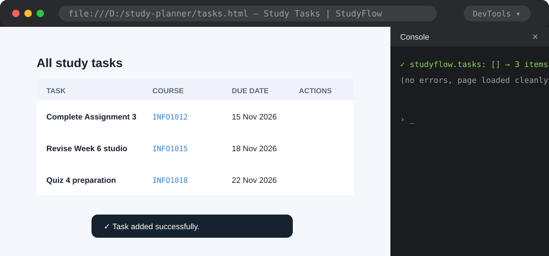

# StudyFlow — My Study Task Manager

**Assignment 3.1 · Web Page Development Portfolio**

StudyFlow is a study task management web application built for students who juggle multiple
assignments, revision tasks, quizzes and project deadlines at the same time. It replaces
handwritten notes and messy spreadsheets with one central, validated, easy-to-use task list.

> **GitHub repository URL (for submission):**
> https://github.com/xi1016/3.1
>
> **Live site (GitHub Pages):** enable *Settings → Pages → Deploy from branch: main / root*
> to publish the portfolio at `https://xi1016.github.io/3.1/`.

---

## Project description

Students often manage academic responsibilities with informal tools — paper diaries or basic
spreadsheets — that break down when several assessments are due in the same week. StudyFlow
solves this by providing a single web page where every study task lives with its title, course
code and name, due date, description and additional notes.

Key capabilities:

- **Create** new study tasks with full details
- **Update** existing tasks (title, course, due date, description, notes)
- **Delete** tasks — with a confirmation dialog before deletion
- **View** all tasks in a table sorted by due date, with a live countdown badge
  (Due today / days left / Overdue)
- **Data validation** — required fields, course-code format and past dates are rejected with
  clear error messages
- **Login gate** — a basic username/password screen restricts access to the task manager
- **Live clock** — current date and time displayed at the bottom of every page

The app runs entirely in the browser and stores tasks in `localStorage`, so no data ever
leaves the user's device.

## Pages

| Page | File | Purpose |
|------|------|---------|
| Home (main) | `index.html` | App overview, image gallery with a cycle button, "About the App" and "About Me" sections |
| Study Tasks | `tasks.html` | Login + create / update / delete / view tasks with validation and clock |
| Project plan & Troubleshooting Blog | `blog.html` | 3-week sprint plan table and two documented, resolved errors |
| Ethics & Privacy | `ethics.html` | Reflection on privacy, data minimisation and ethical design |

## Repository structure

```
study-planner/
├── index.html          # Main home page
├── tasks.html          # Study task management (login + CRUD)
├── blog.html           # Project plan & troubleshooting blog
├── ethics.html         # Ethics & privacy reflection
├── README.md           # This file
├── LICENSE             # MIT License
├── .gitignore
├── css/
│   └── style.css       # All styling (design tokens, layout, components)
├── js/
│   ├── main.js         # Shared: nav, clock, toast
│   ├── gallery.js      # Home page image cycler
│   └── tasks.js        # Login, CRUD, validation, storage
└── images/
    ├── favicon.svg
    ├── study-desk.svg        # Gallery image 1
    ├── study-checklist.svg   # Gallery image 2
    ├── study-graduation.svg  # Gallery image 3
    └── shot-*.svg            # Screenshots used in the troubleshooting blog
```

## How to install and run

No build tools or dependencies are required.

1. **Clone or download** the repository:
   - `git clone <repository-url>` — or download the ZIP and extract it.
2. **Open the site** — either:
   - double-click `index.html` to open it directly in your browser, **or**
   - open the folder in **VS Code** and use the *Live Server* extension
     (right-click `index.html` → “Open with Live Server”).
3. Sign in on the **Study Tasks** page with the demo credentials below and start adding tasks.

Recommended browsers: Chrome, Edge or Firefox (current versions).

## How to use the application

1. **Home page** — read the app overview, cycle through the three study images with the
   ‹ › buttons or dots, and read the About the App / About Me sections.
2. **Sign in** — open **Study Tasks** and log in:
   - Username: `student`
   - Password: `StudyPlan2026`
   *(This is a client-side demonstration login — see the Ethics & Privacy page.)*
3. **Create a task** — fill in the task title, course code (e.g. `INFO1012`), course name,
   due date, description and optional notes, then click **Add task**.
   Invalid input (empty required fields, badly formed course codes, past due dates) is
   rejected with a specific error message under the field.
4. **View tasks** — every task appears in the table, sorted by due date, with a countdown
   badge: *Due today*, *N days left* or *Overdue by N days*.
5. **Update a task** — click **Edit** on its row. The form fills with the task's values and
   switches to “Edit task”; change anything and click **Save changes**.
   Click **Cancel edit** to abandon changes.
6. **Delete a task** — click **Delete** on its row. A confirmation dialog appears;
   choose **Yes, delete it** to confirm or **Cancel** to keep the task.
7. **Sign out** — use the **Sign out** button when finished.
8. The current **date and time** is shown at the bottom of every page.

Tasks persist in the browser's `localStorage` — they are still there after closing and
reopening the page (on the same browser and device).

## Screenshot of the scheduling page



*The Study Tasks page: the task form with validation, and all tasks listed in due-date order
with countdown badges and Edit / Delete actions. Delete always asks for confirmation first.*

## Technologies used

- **HTML5** — semantic structure, forms with native attributes
- **CSS3** — custom properties, Flexbox & Grid, responsive breakpoints, transitions
- **JavaScript (ES5+)** — DOM manipulation, event delegation, form validation, `localStorage`
- **Markdown** — this README and project documentation
- **Git & GitHub** — version control, commits and repository hosting
- **Visual Studio Code** — development environment (Live Server, integrated terminal)

## Credits

- **Author:** Shuhan Chen — Assignment 3.1, Web Page Development
- **Fonts:** [Sora](https://fonts.google.com/specimen/Sora) and
  [Inter](https://fonts.google.com/specimen/Inter) via Google Fonts (OFL licence)
- **Reference documentation:** [MDN Web Docs](https://developer.mozilla.org/) — used for
  `localStorage`, `Date`, `JSON.parse` and form validation APIs
- Course studios and practical sessions (weeks 4–7) provided the foundation for the
  HTML, CSS and JavaScript techniques used here

## Licence

This project is released under the **MIT Licence** — see the [LICENSE](LICENSE) file.
You are free to use, copy and modify it for learning purposes.
